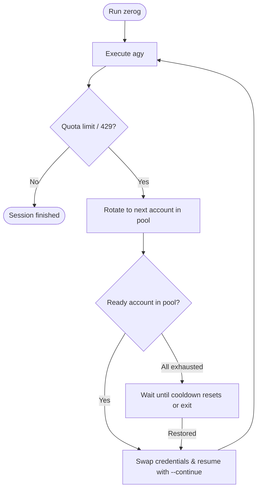

# zerog

[](https://www.npmjs.com/package/zerog)
[](LICENSE)
[](https://nodejs.org)

Multi-account quota manager for Google Antigravity (`agy`).

When an account hits rate limits or quota exhaustion (HTTP 429 / `RESOURCE_EXHAUSTED`), `zerog` swaps credentials and resumes your session (`--continue`) with the next account in the pool.

## How it works



## Installation

```bash
npm install -g zerog
```

Or run on demand:

```bash
npx zerog
```

*(If `agy` is not found on your system, `zerog` installs it automatically.)*

## Usage

Add your accounts once:

```bash
zerog login personal          # opens browser sign-in
zerog login work
zerog add-key dev-key <API_KEY>
```

Then run `zerog` just like you would run `agy`:

```bash
zerog                         # interactive session
zerog -p "write unit tests"   # single prompt turn
```

All `agy` flags and arguments pass through directly.

## Commands

```bash
zerog accounts                # list pool, priorities & cooldown timers
zerog use <id>                # switch active account manually
zerog test <id>               # verify account auth against agy
zerog reset-cooldown <id>     # clear cooldown
zerog delete <id>             # remove account from pool
zerog export accounts.json    # transfer accounts to another machine
zerog import accounts.json    # import accounts on a new machine
zerog web                     # open local web UI (localhost:7890)
```

## Configuration

Config lives in `~/.zerog/config.json`.

```bash
zerog config switch_strategy priority   # priority | round_robin
zerog config cooldown_minutes 60        # default cooldown duration
zerog config agy_path /path/to/agy      # custom agy binary location
```

## License

MIT
