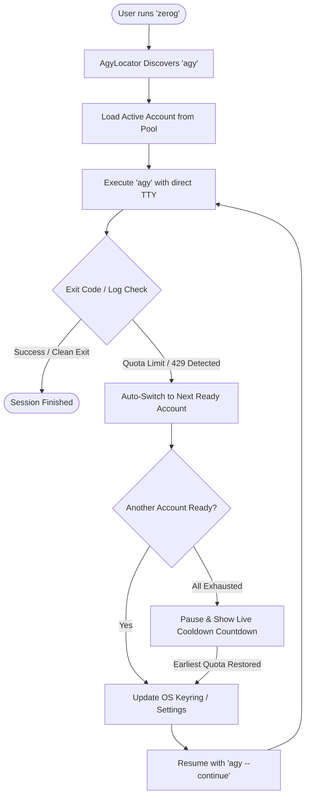

# 🚀 zerog (Zero-G) — Antigravity CLI Account Auto-Switcher

[](LICENSE)
[](https://nodejs.org)
[](https://www.npmjs.com/package/zerog)
[-green.svg)](#-cross-platform-support)

**`zerog`** (Zero-G) is an open-source Node.js application that wraps the **Google Antigravity CLI (`agy`)** to provide transparent, multi-account quota rotation with zero downtime and zero loss of conversation context.

Whenever you run `zerog`, it runs `agy`. When your account reaches its daily quota, plan usage limits, rate limits (HTTP 429), or gRPC `RESOURCE_EXHAUSTED` errors, `zerog` **automatically switches to the next ready account in your pool and resumes your session seamlessly**.

---

## ✨ Features

- ⚡ **Run Instantly via `npx` or `npm`**: No manual compilation or build steps. Pure Node.js with **zero external npm dependencies**.
- 🔄 **Self-Discovering `agy` Path**: `zerog` dynamically locates your `agy` binary across `$PATH`, `~/.local/bin`, `/opt/homebrew/bin`, `/usr/local/bin`, `~/.gemini`, or custom paths with zero manual configuration.
- ⌨️ **100% Native Terminal Fidelity**: Zero input lag, full keyboard typing support, arrow keys, terminal query escapes, and TUI compatibility.
- 🔁 **Transparent Failover**: Automatically catches plan limits, swaps credentials in the OS keyring / settings, and continues the session using `agy --continue`.
- 🛑 **No Infinite Loops**: Prevents continuous retries when all accounts are exhausted.
- ⏳ **Smart Auto-Continue**: When all accounts are in cooldown, `zerog` pauses cleanly, displays a real-time countdown to the earliest reset, and **automatically resumes the instant quota is restored**.
- 👥 **Multi-Account Support**: Manage any combination of Google accounts (via browser OAuth) and Gemini API keys.
- 📦 **Cross-PC Portability**: Export your configured pool on one machine (`zerog export`) and import it on another (`zerog import`) without re-authenticating through a browser.
- 🌐 **Real-Time Web Dashboard**: Built-in visual dashboard (`zerog web`) on `http://localhost:7890` for inspecting account health, switching profiles, and monitoring events.

---

## 🚀 Installation & Quick Start

### Option 1: Run instantly with `npx` (No Install Required)
```bash
npx zerog
```

### Option 2: Install globally via `npm`
```bash
npm install -g zerog
```
Then run anywhere:
```bash
zerog
```

### Option 3: Install from Source
```bash
git clone https://github.com/adalenv/zerog.git
cd zerog
./install.sh
```

---

## ⚡ How It Works



---

## 🛠️ Usage

### Running Antigravity (`agy`)
```bash
# Launch interactive agy session with auto-rotating accounts
zerog

# Run a single prompt turn with auto-retry on quota limits
zerog -p "Refactor the authentication service"

# All native agy flags and subcommands work directly
zerog --continue
zerog models
```

### Managing Your Account Pool
```bash
# View all accounts, priorities, and cooldown statuses
zerog accounts

# Inspect pool health, active account, and detected agy path
zerog status

# Sign into an additional Google account in your browser
zerog login work-account "Work Google Account"

# Add a Gemini API key profile (priority: lower number = higher priority)
zerog add-key api-key-1 "AIzaSy..." 5

# Capture currently logged-in agy session into the pool
zerog capture my-primary

# Manually switch active account
zerog use work-account

# Verify account credentials with agy
zerog test work-account

# Clear cooldown manually for an account
zerog reset-cooldown work-account

# Remove an account from pool
zerog delete work-account
```

### 🌐 Moving to Another PC (Cross-Platform)
```bash
# 1. On your current machine: Export your pool
zerog export my-pool.json

# 2. On your new PC / Mac / Linux: Import it directly
npx zerog import my-pool.json
```
`zerog` automatically restores the accounts, configures the local OS keyring, sets the active account, and you can immediately run `zerog` without logging into browsers again!

### Visual Web Dashboard & Background Watchdog
```bash
# Launch visual web dashboard in browser (default: http://localhost:7890)
zerog web

# Background watchdog daemon (for IDE extensions and background monitoring)
zerog daemon start
zerog daemon status
zerog daemon stop
```

---

## 💻 Cross-Platform Support

| Operating System | Keyring Backend | Requirements |
|---|---|---|
| **macOS** | macOS Keychain (`security`) | Node.js (>= 16) |
| **Linux (Ubuntu / Debian / Fedora / Arch)** | Secret Service D-Bus (`secret-tool`) or file fallback | Node.js & `sudo apt install libsecret-tools` |
| **Windows via WSL** | Linux Secret Service / WSL | Node.js inside WSL |
| **Windows Native** | Windows Credential Manager / API Keys | Node.js from [nodejs.org](https://nodejs.org) |

> [!NOTE]
> **Gemini API Key profiles** (`zerog add-key ...`) work 100% identically across **all operating systems** without any OS keyring dependencies.

---

## ⚙️ Configuration & Discovery

`zerog` stores configuration in `~/.zerog/config.json`. You can inspect or modify settings directly from the CLI:

```bash
# View configuration
zerog config

# Custom agy path override (if agy is in a custom folder)
zerog config agy_path /opt/custom/bin/agy

# Switch strategy: "priority" (default) or "round_robin"
zerog config switch_strategy round_robin

# Cooldown duration in minutes (default: 60)
zerog config cooldown_minutes 45
```

You can also use the `AGY_PATH` environment variable:
```bash
export AGY_PATH="/path/to/custom/agy"
```

---

## 🧪 Testing

`zerog` includes a comprehensive unit test suite using Node.js built-in test runner:

```bash
npm test
```

---

## 📂 Project Structure

```text
zerog/
├── bin/
│   ├── zerog.js               # Executable Node.js CLI entrypoint
│   └── zerog                  # Symlink wrapper
├── lib/
│   ├── index.js               # Root module exports
│   ├── version.js             # Version constant (1.0.0)
│   ├── config.js              # Configuration management (~/.zerog/config.json)
│   ├── agy-locator.js         # Dynamic, cross-platform agy binary discovery
│   ├── account.js             # Account data model & cooldown tracking
│   ├── account-manager.js     # Keyring & settings synchronization logic
│   ├── quota-detector.js      # Quota & HTTP 429 pattern matcher
│   ├── runner.js              # TTY interactive wrapper & auto-switch runner
│   ├── daemon.js              # Background cli.log watchdog
│   ├── notifier.js            # Terminal banners & system notifications
│   └── web-server.js          # Native HTTP REST API & static file server
├── web/
│   └── public/                # Standalone Web Dashboard SPA
│       ├── index.html         # Responsive dashboard interface
│       ├── style.css          # Modern dark-mode styling
│       └── app.js             # Real-time dashboard controller
├── test/
│   └── test_zerog.js          # Node test suite (node:test)
├── .github/workflows/
│   └── ci.yml                 # GitHub Actions CI matrix
├── package.json               # npm / npx package definition
├── install.sh                 # Quick installer script
├── uninstall.sh               # Uninstaller script
├── CONTRIBUTING.md            # Contribution guidelines
├── CHANGELOG.md               # Version history
├── LICENSE                    # MIT License
└── README.md                  # Project documentation
```

---

## 📄 License

This project is licensed under the [MIT License](LICENSE).
