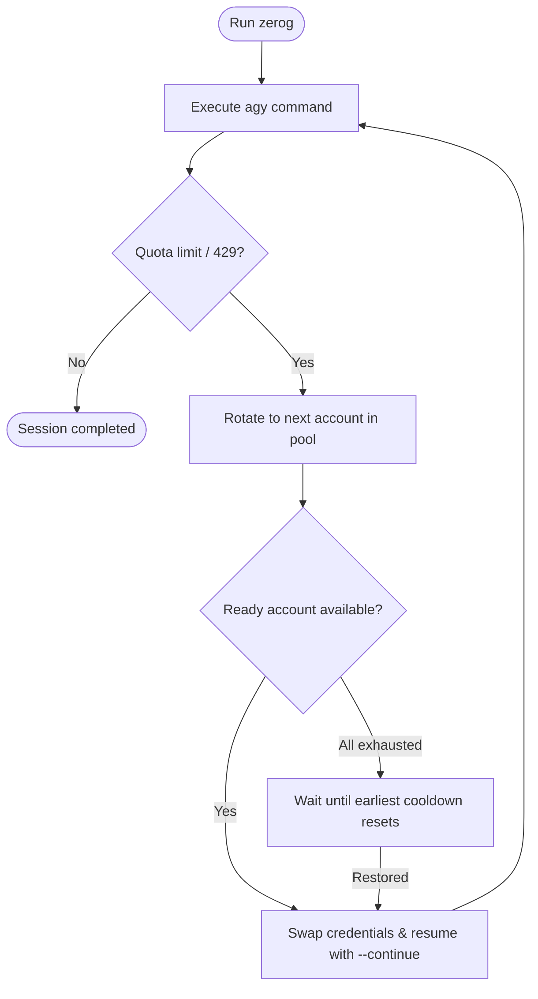

# zerog

[](https://www.npmjs.com/package/@adalenv/zerog)
[](LICENSE)
[](https://nodejs.org)
[](test/test_zerog.js)

Multi-account quota manager and auto-failover wrapper for Google Antigravity (`agy`).

When an account hits rate limits or quota exhaustion (HTTP `429` / `RESOURCE_EXHAUSTED`), `zerog` seamlessly swaps credentials, detects the session state, and resumes execution (`--continue`) with the next available account in your pool.

---

## How It Works



- **Transparent Passthrough**: Standard interactive sessions and one-shot flags (`-p`, `--continue`, etc.) pass directly through to `agy`.
- **Zero Loop on Full Depletion**: If every account in the pool is exhausted, `zerog` halts without infinite loops and displays the exact time until the earliest quota reset.
- **Auto-Discovery**: Locates the `agy` binary across macOS, Linux, and Windows path hierarchies. Automatically prompts or installs `agy` if missing.
- **Native TTY**: Uses raw I/O streaming (`stdio: 'inherit'`) to retain terminal colors, formatting, and interactive prompts.
- **Zero External Dependencies**: Pure Node.js standard libraries for maximum speed and security.

---

## Installation

### Option 1: Install from npm Registry

```bash
npm install -g @adalenv/zerog
```

Or run on demand without installing:

```bash
npx @adalenv/zerog
```

*(Once installed, the CLI command is simply `zerog`)*.

### Option 2: Install from GitHub

```bash
npm install -g git+https://github.com/adalenv/zerog.git
```

Or run directly from GitHub via `npx`:

```bash
npx github:adalenv/zerog
```

*(If `agy` is not found on your system, `zerog` will offer to install it automatically during postinstall.)*

---

## Quick Start

### 1. Add Accounts to Your Pool

Add OAuth accounts (opens Google Sign-In in your browser):
```bash
zerog login personal
zerog login work
```

Or add Gemini API keys:
```bash
zerog add-key dev-key <API_KEY>
```

### 2. Run Commands

Use `zerog` as a drop-in replacement for `agy`:

```bash
zerog                          # Interactive CLI session
zerog -p "build a web server"  # Single-prompt execution
```

When quota limits are reached, `zerog` automatically handles credential rotation and resumes work without losing your prompt history.

---

## Command Reference

| Command | Description |
| :--- | :--- |
| `zerog` | Launch interactive `agy` session with auto-failover |
| `zerog login <id>` | Authenticate and save a new Google OAuth account |
| `zerog add-key <id> <key>` | Add an API key account |
| `zerog accounts` | List all accounts, active status, and cooldown timers |
| `zerog use <id>` | Manually switch the active account |
| `zerog test <id>` | Test authentication validity for an account |
| `zerog reset-cooldown <id>` | Clear the cooldown timer for an account |
| `zerog delete <id>` | Remove an account from the pool |
| `zerog export <file.json>` | Securely export accounts (`0600` permissions) |
| `zerog import <file.json>` | Import accounts from a file |
| `zerog web` | Open the local Web UI dashboard (`http://localhost:7890`) |

---

## Configuration

Settings are stored in `~/.zerog/config.json`.

```bash
# Rotation strategy: 'priority' (default) or 'round_robin'
zerog config switch_strategy priority

# Cooldown duration in minutes (default: 60)
zerog config cooldown_minutes 60

# Custom agy binary path override
zerog config agy_path /usr/local/bin/agy
```

---

## Publishing to npm (Maintainers)

To publish this package to the npm registry:

1. Authenticate with your npm account:
   ```bash
   npm login
   ```
2. Publish with public access:
   ```bash
   npm publish --access public
   ```

---

## Contributing

Contributions, bug reports, and suggestions are welcome! Please read [CONTRIBUTING.md](CONTRIBUTING.md) for details on code style, testing, and pull requests.

To run the test suite:
```bash
npm test
```

---

## License

This project is licensed under the [MIT License](LICENSE).
